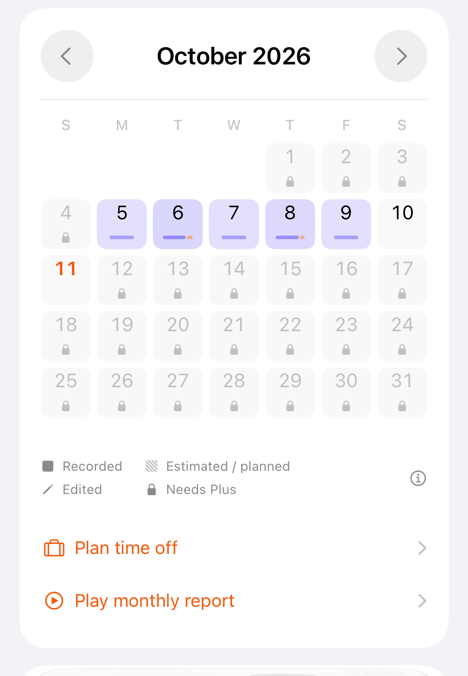

# PR 310 calendar layout review

## Scope and checkout

- Reviewed PR: https://github.com/ififi2017/Off-Work-Countdown/pull/310
- Fetched head: `e96ccc45753c8e81ca90fa70657d184e9c45f580`.
- Local branch: `codex/pr310-calendar-polish`, isolated checkout `/private/tmp/doneat-pr310-review`.
- The existing product checkout and paused ASC recording/upload work were not changed.
- User explicitly requested simulator inspection and then requested a compact legend, improved day indicators, shorter report tabs, checks of other languages, and alignment of the two legend columns with the explanation button.

## Changes

- Calendar marks sit together below each date. A missing holiday caption no longer pushes the work/overtime bar against the bottom edge. The PR's separate date and lock positions remain intact.
- Legend labels use concise localized wording. The full meanings and overtime colour explanation remain in a reachable info popover; accessibility labels retain the full wording.
- A single row is used when it fits. Otherwise a two-row `Grid` shares column origins and text baselines, with intrinsic column widths instead of evenly stretched columns.
- The explanation icon uses the same trailing edge as the calendar action chevrons and centres vertically against the legend. Its hit area remains 44 × 44 pt and follows RTL reading direction.
- The report feature tab reads “Reports” / “报告” and equivalents in all 19 locales. Its accessibility label still describes weekly, monthly and yearly reports.
- Watch/Android localization generation is synchronized with the iOS catalog. Android resources are generated, not hand edited.

## Native visual inspection

Device: iPhone 17e, iOS 27.0, 390 × 844 pt / 1170 × 2532 px, native Debug App. Only this simulator was running. The final UI build succeeded on 2026-10-11 at 15:06 UTC; subsequent catalog changes only restored a pre-existing blank line.

App path: `/private/tmp/doneat-pr310-build/Build/Products/Debug-iphonesimulator/App.app`.

Used existing DEBUG launch arguments for language, month view, onboarding/release-note gates and test entitlement. Waited for the calendar's accessible info button before capture, so loading placeholders do not count as calendar evidence. The release-note demo animates; its stable report label was used as the readiness condition. Screenshots were inspected visually, not merely counted.

All 19 app locales were inspected in the month calendar and the two-tab release-note feature preview:

`en`, `zh-CN`, `zh-TW`, `zh-HK`, `ar`, `de`, `es`, `fr`, `hi-IN`, `id`, `it`, `ja`, `ko`, `mr-IN`, `pt`, `ru`, `th`, `tr`, `vi`.

The changed legend/report labels fit without clipping or overlapping. Korean fits in one legend row; other checked phone locales use two rows. Arabic mirrors the calendar and legend correctly; its six-row month and lower actions remain scrollable. This is not a claim that every unrelated screen in every language was audited.

Additional observations:

- English light and dark month views retain separate dates, centred locks and raised work/overtime bars.
- English maximum accessibility type uses a sheet for the legend. Opening and scrolling it exposed the complete explanation through the final “pale and hatched” line.
- The Simplified Chinese native leave-planning demo visibly shows `补班` on September 20 and October 10, rather than `调休`; day accessibility labels retain the complete make-up-workday meaning. The demo is read-only and no proposal was adopted.
- The existing Hindi/Marathi shift-alarm demo subtitle can ellipsize in its preview card. That unchanged subtitle is outside the legend/report-tab changes and is not counted as fixed.
- No physical-device, iPad, Duo or landscape visual inspection was performed in this review.

Contact sheets (native captures resized for review):

- [English / Simplified Chinese](assets/2026-10-11-pr310-calendar/languages-0.jpg)
- [Traditional Chinese / Hong Kong / Arabic / German](assets/2026-10-11-pr310-calendar/languages-1.jpg)
- [Spanish / French / Hindi / Indonesian](assets/2026-10-11-pr310-calendar/languages-2.jpg)
- [Italian / Japanese / Korean / Marathi](assets/2026-10-11-pr310-calendar/languages-3.jpg)
- [Portuguese / Russian / Thai / Turkish / Vietnamese](assets/2026-10-11-pr310-calendar/languages-4.jpg)

Full-resolution native screenshots and Gradle log are kept locally under `/private/tmp/doneat-pr310-qa/`.

## Automated validation

- Native simulator build/run: passed, XcodeBuildMCP build log `build_run_sim_2026-10-11T15-06-17-151Z_pid46622_1857f7b1.log`.
- `npm run check:ios`: passed.
- `npm run check:ios-strings`: passed, including all 19 translations.
- `npm run check:android-strings`: passed.
- `node scripts/generate-watch-localizations.mjs --check`: passed.
- `npm test`: 50 files / 552 tests passed.
- `git diff --check`: passed.
- Android full Gradle validation: passed in 7m 19s (188 tasks). `:core:domain:test :core:data:test :core:designsystem:testDebugUnitTest :app:testDebugUnitTest :app:lintDebug :app:assembleDebug :app:assembleRelease` all completed successfully. 690 unit tests passed, zero failures/errors/skips across domain (437), data (95), design system (12) and app (146). Both APKs assembled; these local artifacts were not installed or uploaded. Used the installed JBR at `/Volumes/BACKUP/Applications/Android Studio.app/Contents/jbr/Contents/Home` and existing Android SDK.

Remote checks on the fetched PR head: GitHub CI, Rust, Android and Xcode Cloud iOS succeeded; Xcode Cloud watchOS remains `ACTION_REQUIRED` and the aggregate `App | PR Check` status is `ERROR`. These remote statuses do not validate the unpushed local polish changes. No PR merge or store submission was performed.
