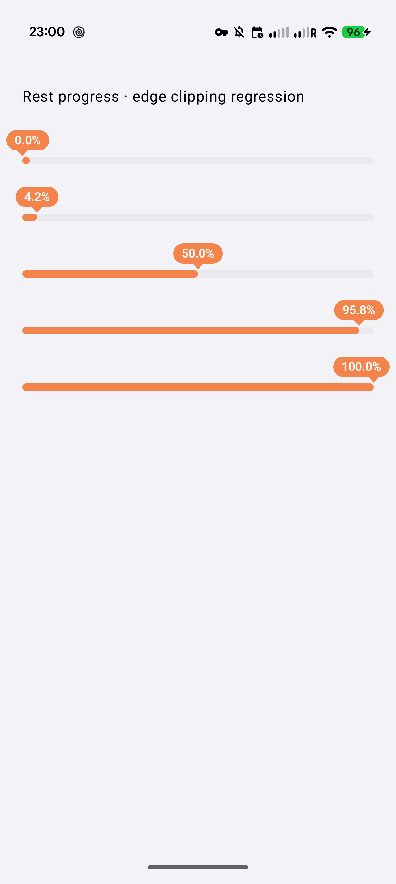
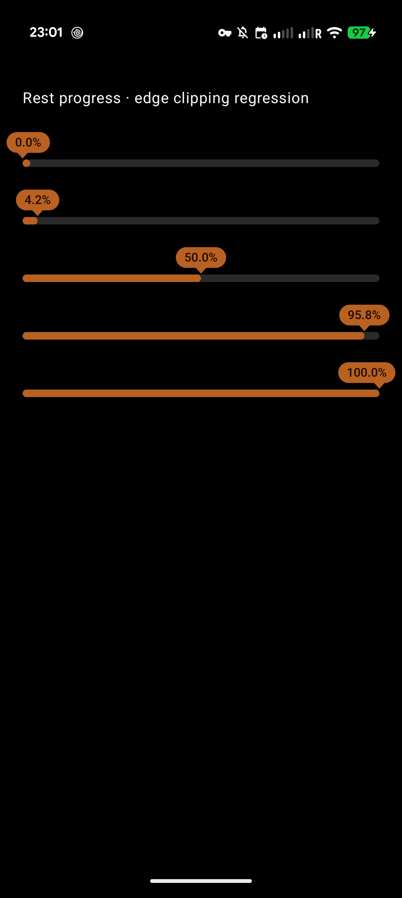

# Android progress clipping — 2026-11-01

The rest meter's layout-sized alpha layer clipped its bubble overhang. The meter now allocates an expanded group-opacity layer while preserving pointer alignment and layout dimensions.

## Pixel acceptance

Pixel 10 Pro / Android 17: production CN 3.2.1 (7) upgraded in place to signed 3.2.5 (10), without clearing data. Existing rest screen at 97.6% (dark) and 97.7% (light) showed the complete bubble. Personal-state screenshots remain local; committed screenshots below contain only synthetic debug gallery values. The gallery covers 0%, 4.2%, 50%, 95.8%, 100% at the same 72% opacity. All labels and pointers are visible. System night mode restored to auto; foreground returned to production CN.

## Release identity and validation

- Source: `9954272f4c5bdd9aa222c28aa1d3d54f4c467538`; tag `android-cn-v3.2.5-10`.
- [CN build](https://github.com/ififi2017/Off-Work-Countdown/actions/runs/41317206101): unsigned cloud build, local official signing using the isolated signing helper, then independent source-record/SDK/signature/hash verification.
- APK: 6,671,723 bytes; SHA256 `93e40eff64229551cd42def1a5d63e25e85bc1368d29c6c2c861e55d9d611bcd`.
- Certificate SHA256: `2554fa47d4cb553bf22c1d8821769ca2c27381821c65fe68af835a9336bcd41b` (unchanged).
- [Download](https://downloads.doneat.app/android/cn/3.2.5-10/93e40eff6422/doneat-cn-3.2.5-10.apk) body hash verified against the signed candidate.
- Local CN: 790 tests, zero failures/errors/skips; lintDebug and assembleDebug passed. CI Play/CN regression checks and release builds passed. Version consistency and check:ios passed; local headless iOS Simulator build succeeded. No iOS visual inspection or Apple/Desktop release.
- [Play release CI](https://github.com/ififi2017/Off-Work-Countdown/actions/runs/41317101157): 3.2.5 (146), alpha upload completed. Store review approval/public rollout not asserted.

## Publication

- [Website PR49](https://github.com/ififi2017/doneat.app/pull/49), merge `37e0b3e4ec75df46581a02f24d35b05c1e514cc9`; CN/global SEO checks and Vercel passed. Local Astro check and CN build/link/release checks passed.
- Domestic five-page subtree atomically published with origin body verification; other Chinese pages remain byte-identical. Existing TLS/API/DNS configuration untouched; rollback directory retained on server.
- Public download page body matches the build. Browser inspection confirmed 3.2.5 (10), correct download/source links and release notes.
- Cloudflare staging `d87035d3-9e06-4ba8-8192-71fce16cf38b` added CN10 while keeping feed9. After website verification, deployment `3c74a108-8ee3-4289-ac5d-d25a8a417b67` switched latest to10. Old version assets retained; public latest body matches prepared metadata.
